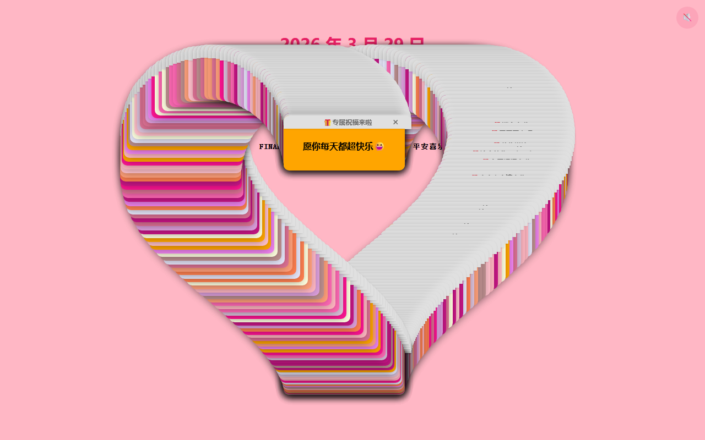

# LST&ZZL


一个纯前端的互动祝福页：点击 **「打开」**，300 份祝福气泡会一个接一个从屏幕各处弹出来；

点开其中那份特别的祝福（`平安喜乐`）右上角的 **×**，屏幕上所有气泡会缓缓移动、**拼成一颗心**；

心形停留片刻后，全屏出现最后的祝福 —— **天天开心**。

> 整个项目只有一个 HTML 文件，没有构建、没有依赖、没有后端。双击就能看，丢到任意静态托管上就能给所有人访问。

## 预览

| 300 份祝福弹出 | 拼成一颗心 | 最终祝福 |
| --- | --- | --- |
|  |  |  |

---

## 在线体验

- 演示地址：<https://zzl071214.github.io/lst-blessing/>

## 本地预览

直接双击 `index.html` 即可。

想用「服务器」的方式预览（推荐，行为和线上完全一致）：

```bash
# Python 3
python -m http.server 8080

# Node.js
npx serve .
```

然后打开 <http://localhost:8080>。

## 部署到 GitHub Pages

1. 新建仓库并推送本目录（仓库名例如 `lst-blessing`）：

   ```bash
   git init
   git add .
   git commit -m "feat: LST 祝福弹窗互动页面"
   git branch -M main
   git remote add origin https://github.com/<你的用户名>/lst-blessing.git
   git push -u origin main
   ```

2. 打开仓库 **Settings → Pages**；
3. **Source** 选 `Deploy from a branch`，**Branch** 选 `main` / `root`，保存；
4. 等 1 分钟左右，访问 `https://<你的用户名>.github.io/lst-blessing/`。

仓库里已经放了 `.nojekyll`，避免 GitHub Pages 的 Jekyll 处理干扰静态资源。

### 其他托管方式

因为只有一个静态文件，Vercel / Netlify / Cloudflare Pages / 对象存储都能直接部署，把仓库连上去、构建命令留空、输出目录填 `/` 即可。

## 自定义

打开 `index.html`，顶部 `<script>` 里的 `CONFIG` 是最常改的地方：

| 配置项 | 说明 | 默认值 |
| --- | --- | --- |
| `totalPopups` | 祝福气泡总数（含那 1 份特殊祝福） | `300` |
| `popupInterval` | 每个气泡出现的间隔（毫秒） | `70` |
| `specialBlessing` | 特殊祝福文案，点它的 × 触发心形 | `"平安喜乐"` |
| `finalBlessing` | 全屏最终祝福文案 | `"天天开心"` |
| `finalTip` | 最终祝福顶部的小标题 | `"💌 平安喜乐"` |
| `heartFormMs` | 小弹窗排列成爱心所需时间（毫秒），需与 CSS 的 `--heart-duration` 一致 | `15000` |
| `heartHoldMs` | 爱心完全就位后再停留多久显示全屏祝福（毫秒） | `3000` |

> 时序说明：点击特殊祝福的 × 后，小弹窗需要 `heartFormMs`（15 秒）飞到心形位置，**完全就位后再停留 `heartHoldMs`（3 秒）**才出现全屏祝福。想更快出全屏，就把这两个值一起调小（改 `--heart-duration` 时记得同步改 `heartFormMs`）。

其他常见的改动：

- **换祝福语**：编辑 `normalBlessings` 数组，随便加多少条，会随机抽取。
- **换气泡颜色**：编辑 `popupBgColors` 数组。
- **换顶部两行日期和署名**：直接改 `<h1 class="main-title">`（第一行）、`<p class="subtitle">`（第二行）和 `<p class="signature">`（署名）。两行字号由 CSS 统一控制（`.main-title` / `.subtitle` 的 `font-size`）。
- **换背景音乐**：音乐已自托管在仓库根目录（`lst.mp3`），直接替换这个文件即可，改名就同步改 `index.html` 里第一行 `<source>` 的 `src`。

> 音乐说明：浏览器会拦截「自动播放」，所以页面右上角有一个 🎵 按钮，点它（或点「打开」）才会开始播放。若外链音乐失效，页面其他功能不受影响。

### 为什么音乐放在仓库里自托管

之前用的是外部音乐直链，踩过一个真实的坑：那条链接后来失效了（302 跳转到 `music.163.com/404`，返回的是 HTML 错误页而不是音频）。由于 `<source>` 的**回退行为在各浏览器和 App 内置浏览器里并不一致** —— Safari 和部分 WebView 容易卡在第一个失效源上，Chrome/Edge 则会回退到下一个 —— 结果就是「同一个网址，不同软件听到的音乐不一样」。

现在把 mp3 放进仓库，音源与页面**同源**，所有浏览器和 App 表现一致：

```
背景音乐  : lst.mp3
大小      : 572,072 字节（约 0.55 MB）
规格      : MPEG-1 Layer 3 / 128 kbps / 44.1 kHz / 立体声
时长      : 约 36 秒（循环播放）
```

同时保留了一条抖音 CDN 链接作为兜底，但**失效的链接不会再放在第一位**（那正是问题的根源）。

## 兼容性与无障碍

- 移动端自适应：心形缩放跟随视口，文字过长自动放宽气泡，不会溢出。
- 支持系统「减弱动态效果」（`prefers-reduced-motion`）：会自动缩短动画。
- 关闭按钮带 `aria-label`，主按钮有可见焦点样式。
- 已在 Chromium 系（Edge / Chrome）与移动端浏览器实测。

## 目录结构

```
.
├── index.html      # 全部内容：结构、样式、逻辑
├── lst.mp3         # 背景音乐（自托管，同源）
├── jumping.html    # 备用入口（在 iframe 里打开时重写父级地址）
├── screenshots/    # README 用的预览图
├── .nojekyll       # 让 GitHub Pages 跳过 Jekyll
├── .gitattributes  # 统一行尾、声明二进制文件
├── LICENSE         # MIT
└── README.md
```

## License

[MIT](LICENSE) © 2026 zzl
